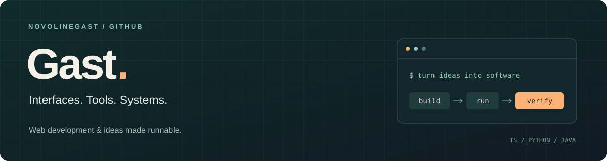

  

  <a href="https://github.com/NovolineGast/RepoRepro">RepoRepro</a> &nbsp; / &nbsp;
  <a href="https://github.com/NovolineGast?tab=repositories">All projects</a>

## Hey, I'm Gast.

I build web applications, desktop software, and developer tools. My projects span TypeScript, Python, and Java — from user interfaces to the systems behind them.

喜欢把想法做成能运行的东西，也喜欢把问题追到能复现、能验证。

- **Web & desktop** — TypeScript, JavaScript, HTML/CSS, and Electron.
- **Developer tooling** — Python, MCP integrations, and reproducible execution.
- **Java & beyond** — Minecraft tooling, bytecode, and native integration.

## In focus · RepoRepro

### A bug report is the beginning. Reproducible evidence is the goal.

[**RepoRepro**](https://github.com/NovolineGast/RepoRepro) turns Python bug reports into reproducible, verifiable Capsules: capture an issue, run a reviewed test, compare original and fixed commits, and preserve the environment and evidence for replay.

`GitHub Issue` → `Reproduce` → `Verify` → `Package & replay`

**Python · pytest · Docker · CLI** 
[Explore the project →](https://github.com/NovolineGast/RepoRepro#readme)

## Selected projects

| Project | What I'm building | Technologies |
| :--- | :--- | :--- |
| [**HUNAUMCL**](https://github.com/NovolineGast/hunaumcl) | A Minecraft Java Edition desktop launcher, with instance management, installation workflows, and a custom interface. | TypeScript · Electron · CSS |
| [**PowerDesigner MCP**](https://github.com/NovolineGast/powerdesigner-mcp) | An MCP bridge that lets AI agents operate PowerDesigner through COM automation. | Python · MCP · COM |
| [**YCPPlus**](https://github.com/NovolineGast/YCPPlus) | Java code obfuscation tooling with a self-hosted authentication server. | Java · C++ · Python |

## My toolbox

**Languages** &nbsp; `TypeScript` `JavaScript` `Python` `Java` `C++` `HTML` `CSS` 
**Applications** &nbsp; `Web UI` `Electron` `CLI tools` `MCP` 
**Engineering** &nbsp; `Git` `Docker` `pytest` `GitHub Actions`

---

  From interface to runtime. From an idea to something you can run.

